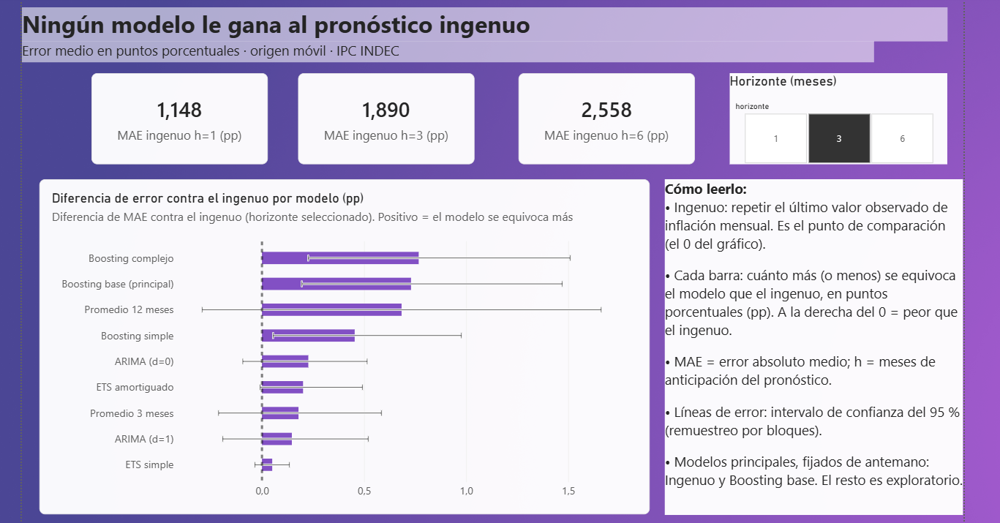
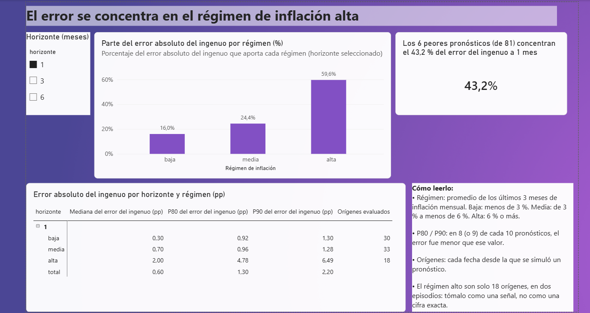
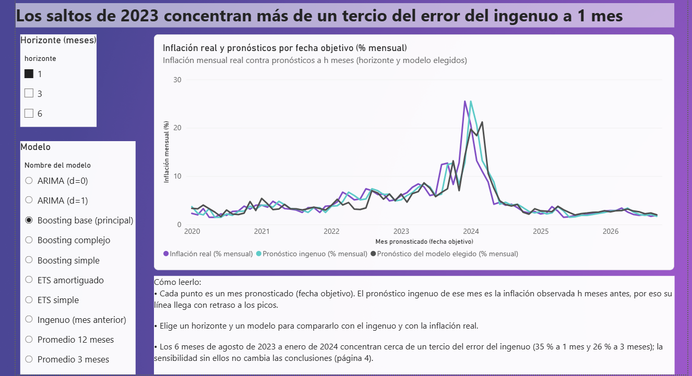
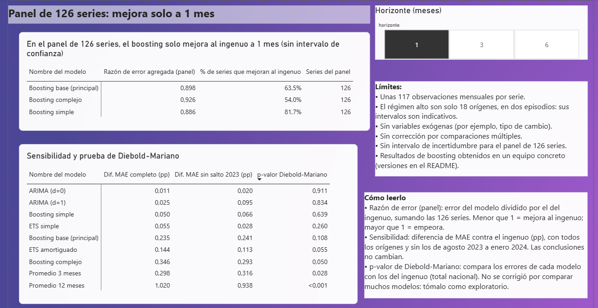

# Forecasting monthly inflation in Argentina (INDEC CPI) with rolling-origin validation

A forecasting study of Argentina's monthly CPI inflation: ten forecasting methods (a naive baseline, moving averages, ETS, ARIMA and a global gradient boosting model) compared out of sample, at 1, 3 and 6 months ahead, with the error measured by inflation regime.

## Resumen en español

**Pregunta:** usando solo la historia de la inflación mensual argentina (IPC del INDEC), ¿con cuánta anticipación y con qué error se puede pronosticar mejor que con un método ingenuo, y en qué regímenes de inflación falla el pronóstico?

**Resultado:** con solo la historia de la serie, ningún modelo (ETS, ARIMA, boosting) le ganó al ingenuo, validando con origen móvil (ventana creciente); dentro de las familias ETS y boosting, la configuración más compleja empeoró. Con estos datos y esta validación, lo útil del proyecto es el error cuantificado por régimen: el pronóstico ingenuo se equivoca poco cuando la inflación es baja y mucho cuando es alta, y el régimen alto (18 orígenes de evaluación) concentra cerca del 60 % de su error absoluto total.

**Qué incluye:** código reproducible (Python, PostgreSQL en Docker, MLflow), un dashboard de Power BI en español de cuatro páginas y este README en inglés, con las limitaciones declaradas.

## Business question

Using only the history of Argentina's monthly CPI inflation, how far ahead and with what error can it be forecast better than a naive method, and in which inflation regimes does the forecast fail?

## Decision it enables

How much to trust a forecast 1, 3 and 6 months ahead when budgeting or adjusting contracts, and in which situations to distrust it.

## Metric

Mean absolute error (MAE) in percentage points (pp) of monthly inflation, total and by regime, against the naive forecast (last observed value), with rolling-origin validation.

## Key result

Using only the history of the series, no model (moving averages, ETS, ARIMA, gradient boosting) beat the naive forecast with an interval that supports it, at 1, 3 or 6 months. Within the ETS and boosting families, the more complex configuration did worse at every horizon, and the moving averages did not help either. The useful result is the quantified error of the naive forecast and where it fails: in the high-inflation regime.

**Table 1.** Naive MAE (pp) and, for each model, the difference in MAE against the naive forecast with its 95 % interval (all origins, regime "total"). Positive values mean the model is worse than the naive forecast; an interval that excludes 0 means the difference is distinguishable from zero. Source: `dashboard/datos/vw_evaluacion.csv`.

| Model | h=1 | h=3 | h=6 |
|---|---|---|---|
| **Naive MAE (pp)** | **1.148** | **1.890** | **2.558** |
| `arima_d0` | +0.011 [-0.163; +0.173] | +0.227 [-0.094; +0.515] | +0.350 [-0.119; +0.861] |
| `arima_d1` | +0.025 [-0.233; +0.288] | +0.146 [-0.193; +0.521] | +0.044 [-0.305; +0.422] |
| `ets_amortiguado` | +0.144 [+0.014; +0.306] | +0.201 [-0.009; +0.493] | +0.260 [-0.043; +0.766] |
| `ets_simple` | +0.055 [-0.007; +0.122] | +0.050 [-0.035; +0.135] | +0.014 [-0.064; +0.086] |
| `gb_base` | +0.235 [-0.014; +0.493] | +0.730 [+0.195; +1.471] | +0.555 [-0.453; +1.922] |
| `gb_complejo` | +0.346 [+0.091; +0.623] | +0.768 [+0.227; +1.510] | +0.626 [-0.521; +2.161] |
| `gb_simple` | +0.050 [-0.166; +0.235] | +0.454 [+0.055; +0.977] | +0.434 [-0.057; +1.026] |
| `media_12m` | +1.020 [+0.401; +1.822] | +0.684 [-0.293; +1.662] | +0.520 [-0.572; +1.934] |
| `media_3m` | +0.298 [+0.056; +0.626] | +0.179 [-0.213; +0.585] | +0.130 [-0.175; +0.550] |

For example, `gb_base` (the main boosting configuration, fixed in advance) is worse than the naive forecast at 3 months, with an interval that excludes 0 (Diebold-Mariano p = 0.037, uncorrected for multiple comparisons). At 1 and 6 months no model has an interval entirely below 0.

**Panel of 126 series.** The boosting model is global: it learns from all 126 series (18 CPI codes x 7 regions). For `gb_base` the aggregate error ratio against the naive forecast is 0.898 / 1.063 / 1.011 (h = 1 / 3 / 6), and it improves on the naive forecast in 63.5 / 27.0 / 38.1 % of the series. There is no uncertainty interval for the panel, so this result is exploratory.

## Where the naive forecast fails

Regimes are defined from the 3-month moving average of monthly inflation: **low** below 3 %, **medium** from 3 % to below 6 %, **high** at 6 % or more. The thresholds were fixed in the exploratory analysis, before any model was evaluated, and use only data available at the forecast origin. A forecast is assigned to the regime in force at its origin.

**Table 2.** Absolute error of the naive forecast by regime and horizon. The last column is the share of the naive forecast's total absolute error that comes from each regime. Sources: `dashboard/datos/vw_error_ingenuo.csv`, `vw_evaluacion.csv` and `vw_pronosticos.csv`.

| Regime | h | Origins | Median abs. error (pp) | P90 abs. error (pp) | Naive MAE (pp) | Share of naive total abs. error |
|---|---|---|---|---|---|---|
| low | 1 | 30 | 0.30 | 1.30 | 0.497 | 16.0 % |
| low | 3 | 28 | 0.60 | 1.20 | 0.682 | 12.8 % |
| low | 6 | 25 | 1.00 | 2.06 | 1.128 | 14.5 % |
| medium | 1 | 33 | 0.70 | 1.28 | 0.688 | 24.4 % |
| medium | 3 | 33 | 1.10 | 2.18 | 1.127 | 24.9 % |
| medium | 6 | 33 | 1.00 | 2.84 | 1.358 | 23.0 % |
| high | 1 | 18 | 2.00 | 6.49 | 3.078 | 59.6 % |
| high | 3 | 18 | 3.35 | 12.45 | 5.167 | 62.3 % |
| high | 6 | 18 | 5.00 | 17.47 | 6.744 | 62.4 % |

The high-inflation regime is 18 origins out of 81 at 1 month, yet it accounts for 59.6 % of the naive forecast's total absolute error (62.3 % at 3 months and 62.4 % at 6 months). At 1 month the median absolute error of the naive forecast is 2.00 pp in the high regime against 0.30 pp in the low regime, and its 90th percentile is 6.49 pp against 1.30 pp. At 1 month, the 6 worst origins alone account for 43.2 % of the naive forecast's total absolute error.

In practice: at 1 month, the median absolute error of the naive forecast is 0.30 pp in the low regime and 0.70 pp in the medium regime; in the high regime it is 2.00 pp, and about one origin in ten had an error of 6.49 pp or more. No model tested here reduces these errors with an interval that supports it (see Table 1 for the total; the regime-level intervals are in `vw_evaluacion.csv`).

**Practical reading.** To budget or adjust contracts, use the naive forecast as the reference and the error figures in Table 2, by regime, as the typical error to expect at each horizon. In these data, no model more complex than the naive forecast improved on it with an interval that supports it. This reading applies only to forecasts built from the series' own history; the project has no exogenous variables.

## Context for 2023

This section is context only: it does not claim causality, and the project has no exchange-rate data.

Monthly inflation (CPI general level, national) jumped from 6.3 % in July 2023 to 12.4 % in August, and from 12.8 % in November to 25.5 % in December. Two official exchange-rate jumps happened at those dates: on 14 August 2023 the Central Bank moved the official wholesale rate to ARS 350 per US dollar (about 22 % above the previous close), and on 12-13 December 2023 the government announced a move of the official rate from about ARS 400 to ARS 800 (the peso lost about 50 % of its value). Sources:

- [Bloomberg Línea, 14 Aug 2023](https://www.bloomberglinea.com/2023/08/14/devaluacion-en-argentina-tras-las-paso-el-dolar-oficial-salta-22/)
- [El Economista](https://eleconomista.com.ar/economia/el-gobierno-devaluo-20-subio-valor-dolar-oficial-3655-suba-tasa-118-n65225)
- [MercoPress, 13 Dec 2023](https://en.mercopress.com/2023/12/13/argentina-devaluation-and-austerity-measures-announced)
- [Reuters dispatch, via Lincoln Daily News, 13 Dec 2023](https://archives.lincolndailynews.com/2023/Dec/13/NEWS/business_n.shtml)

**Sensitivity.** Removing the origins whose target month falls between 2023-08 and 2024-01 (6 origins) does not change the conclusions: the naive MAE falls to 0.801 / 1.514 / 2.067 pp (h = 1 / 3 / 6), and no model improves on it (every difference is positive, the smallest being +0.014 pp, and no interval lies below 0). Those 6 origins account for about 35 % of the naive forecast's total absolute error at h = 1 and 26 % at h = 3. Sources: `dashboard/datos/evaluacion_sensibilidad.csv` and `vw_pronosticos.csv`.

## Dashboard

A Power BI dashboard with four pages, in Spanish:

1. **Resultado**: difference in MAE against the naive forecast, by model, with 95 % intervals.
2. **Dónde falla el ingenuo**: the naive forecast's error by regime and horizon.
3. **Real vs pronóstico**: observed inflation against the forecasts, with the 2023 jumps.
4. **Panel y límites**: the 126-series panel and the limits of the evidence.






- [`dashboard/inflation_forecast.pbix`](dashboard/inflation_forecast.pbix): the Power BI file (Import mode, over the local PostgreSQL database described below).
- [`dashboard/inflation_forecast.pdf`](dashboard/inflation_forecast.pdf): the four pages as a PDF.
- [`dashboard/MEDIDAS.txt`](dashboard/MEDIDAS.txt): the measures, visuals and control values (in Spanish).
- `dashboard/datos/`: CSV exports of the seven database objects the dashboard reads, kept as a backup.

There is no published online version of the dashboard. The `.pbix` keeps the data that was imported when it was saved, so it opens without the database; refreshing it requires the local PostgreSQL described below.

## Method

- **Rolling-origin validation.** Expanding window with an initial window of 36 months. Forecast origins: 81 / 79 / 76 at h = 1 / 3 / 6. Models are refitted at every origin using only information available at that date.
- **Regimes** (definition above) fixed before any evaluation.
- **Models.** Naive (last observed value); 3- and 12-month moving averages; simple and damped ETS; ARIMA with d = 0 and d = 1; and three global gradient boosting configurations (`gb_simple`, `gb_base`, `gb_complejo`) trained on the panel of 126 series. The boosting configurations and `gb_base` as the main one were fixed in advance.
- **Evaluation.** For each origin, the difference between the absolute error of the model and that of the naive forecast. 95 % interval from a moving-block bootstrap (5000 replicates, seed 0, block length 3 / 3 / 6 months at h = 1 / 3 / 6). Diebold-Mariano test with the Harvey-Leybourne-Newbold correction. The main models, fixed in advance, are the naive forecast and `gb_base`; the others are exploratory.
- **Storage and tracking.** Results are loaded into PostgreSQL (schema `inflacion`, 10 tables and 3 views) and logged in MLflow, one run per model and horizon.

## Limitations

- About 117 monthly observations per series.
- Regime breaks in 2023-2024.
- The high-inflation regime has 18 origins in two episodes, so its intervals are indicative.
- No exogenous variables (for example, the exchange rate).
- No correction for multiple comparisons.
- No uncertainty interval for the 126-series panel results.
- The boosting results were obtained on one specific machine (see Environment and reproducibility).
- The validation uses the data as they are today, not the vintages available at the time.

## Data

INDEC, *IPC: series por divisiones* (`serie_ipc_divisiones.csv`), downloaded on 2026-11-11 from <https://www.indec.gob.ar/ftp/cuadros/economia/serie_ipc_divisiones.csv>.

- SHA-256: `1b1742354bcbcd53e85b15bb76311e5a607f94ab4497ebd3a91f00b426a40e38`
- Shape: 14,868 rows = 18 series x 7 regions x 118 months, from December 2016 to September 2026.
- The core analysis uses the general level, region "Nacional". The global model uses the panel of 126 series (18 series x 7 regions).
- The second INDEC file (`serie_ipc_aperturas.csv`, the CPI by openings) was downloaded for an optional second stage; it is not used and is not included in this repository.

## Reproduce

Requirements: Python 3.12 and Docker Desktop.

```
python -m venv .venv
.venv\Scripts\activate          # Windows;  source .venv/bin/activate on Linux/macOS
pip install -r requirements.txt
```

Copy `.env.example` to `.env` and set the database user, name and password (`.env` is not versioned). Start the database:

```
docker compose up -d
```

Run the scripts from the project root, in this order:

| # | Command | What it does |
|---|---|---|
| 1 | `python src/ingest.py` | cleans the raw CSV into `data/processed/ipc_divisiones_tidy.csv` |
| 2 | `python src/backtest.py` | naive and moving-average baselines, rolling-origin backtest |
| 3 | `python src/modelos_estadisticos.py` | ETS and ARIMA per series |
| 4 | `python src/modelo_global.py` | global gradient boosting on the 126-series panel |
| 5 | `python src/evaluacion.py` | evaluation by regime and horizon, intervals, Diebold-Mariano |
| 6 | `python src/cargar_postgres.py` | loads the results into PostgreSQL (needs the database running) |
| 7 | `python src/registrar_mlflow.py` | logs 30 runs in MLflow (`mlflow.db`) |
| 8 | `python src/exportar_dashboard.py` | exports the dashboard objects to `dashboard/datos/` (optional backup) |

The exploratory analysis is in `notebooks/01_eda.ipynb`. The SQL for the schema, views and queries is in `sql/`. To browse the logged runs: `mlflow ui --backend-store-uri sqlite:///mlflow.db`.

## Environment and reproducibility

Official results were obtained with Python 3.12.10 on Windows, 8 processors, and these pinned versions: pandas 3.1.1, numpy 2.5.4, scikit-learn 1.9.1, scipy 1.18.1, statsmodels 0.15.0, mlflow 3.18.0, matplotlib 3.11.2, ipykernel 7.4.0, sqlalchemy 2.0.57, psycopg2-binary 2.9.13 (see `requirements.txt`). The boosting results depend on hardware and library versions, so they may differ slightly on another environment. SQLAlchemy is pinned to the 2.0 series. The results were logged in MLflow (30 runs). The result CSVs are deterministic: two consecutive runs produce identical files.

## Author and license

Diego Robledo · GitHub: [didacus7771](https://github.com/didacus7771) · LinkedIn: [diego-robledo](https://www.linkedin.com/in/diego-robledo-00829026b)

Code under the MIT License (see [`LICENSE`](LICENSE)). The INDEC data is not covered by this license; see the source in the Data section.
