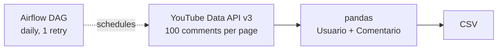

# YouTube comments ETL

Extracts all the comments of a YouTube video with the YouTube Data API v3, organizes them in a users-and-comments table, and is set up to run daily with Apache Airflow.



## What it does

1. **Extract:** `get_video_comments()` calls `commentThreads().list()` and follows `nextPageToken` until there are no more pages, collecting the author and the text of every top-level comment.
2. **Transform:** builds a DataFrame with the columns `Usuario` and `Comentario`.
3. **Load:** saves the table to a CSV (`comentarios_video_dross.csv` is the sample output).
4. **Orchestrate:** `dag.py` defines an Airflow DAG with a daily schedule and one retry after 5 minutes.

## Files

| File | Purpose |
|---|---|
| `yt_etl.py` | API client, pagination loop, DataFrame, CSV |
| `dag.py` | Airflow DAG |
| `comentarios_video_dross.csv` | Sample output |
| `requirements.txt` | Python dependencies |

## How to run

1. Create a YouTube Data API v3 key in Google Cloud Console.
2. Put the key in the script (never commit a real key) and set the `video_id` you want.
3. Run:

```bash
pip install -r requirements.txt
python yt_etl.py
```

## Next steps

- Read the API key from an environment variable.
- Point the DAG task at the script file and run it inside Airflow.
- Load the table to a database or cloud storage instead of a local CSV.

## Tools

Python, pandas, google-api-python-client, Apache Airflow.
