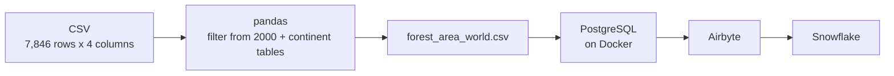

# Global forest area ETL: Python, PostgreSQL, Airbyte and Snowflake

Same method as the inflation project, applied to forest-area data: explore and clean a CSV with pandas, split it by continent, load it into PostgreSQL on Docker, and sync it to Snowflake with Airbyte.



## Pipeline

### 1. Extract and explore
- Loads `forest-area-km.csv`: 7,846 rows and 4 columns.
- Checks data types and null values per column.
- **Cleaning decision:** the nulls correspond to the code of continents and regions, which does not exist for those rows (missing not at random). I left them untouched, because splitting by country removes those rows.

### 2. Transform
- Keeps the records from the year 2000 onward.
- Groups countries by continent with lists and `isin()`, and adds a `Continent` column to each table.
- Saves one CSV per continent and combines them into `forest_area_world.csv`.

### 3. Load
- `postgres_docker.yml` starts PostgreSQL in Docker and mounts the project folder in the container.
- The tables are then synced to Snowflake with Airbyte.

## Files

| File | Purpose |
|---|---|
| `fore_etl.ipynb` | Exploration and transformation notebook |
| `postgres_docker.yml` | Docker Compose file for PostgreSQL |
| `forest-area-km.csv` | Source data |
| `forest_area_*.csv` | Output tables by continent and combined file |
| `requirements.txt` | Python dependencies |

## How to run

```bash
pip install -r requirements.txt
jupyter notebook fore_etl.ipynb           # edit the CSV path at the top

# set your own POSTGRES_PASSWORD and the volume path in the file first
docker compose -f postgres_docker.yml up -d
```

## Tools

Python, pandas, Docker, PostgreSQL, Airbyte, Snowflake.
