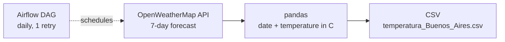

# Weather ETL: Buenos Aires forecast with Airflow

A small, complete pipeline: it pulls the 7-day weather forecast for Buenos Aires from the OpenWeatherMap API, turns it into a clean table, and runs once a day through an Apache Airflow DAG.



## What it does

1. **Extract:** requests the forecast for `Buenos Aires, AR` in metric units (`weather_etl.py`).
2. **Transform:** builds a DataFrame with two columns, `Fecha` and `Temperatura (Celsius)`.
3. **Load:** writes the result to `temperatura_Buenos_Aires.csv`.
4. **Orchestrate:** `weather_dag.py` defines a DAG that runs the extraction every day, retrying once after 5 minutes if it fails.

## Files

| File | Purpose |
|---|---|
| `weather_etl.py` | Standalone script: API call, DataFrame, CSV |
| `weather_dag.py` | Airflow DAG (`PythonOperator`, daily schedule, 1 retry) |
| `temperatura_Buenos_Aires.csv` | Sample output |
| `requirements.txt` | Python dependencies |

## How to run

```bash
pip install -r requirements.txt
# put your own OpenWeatherMap API key in the script (do not commit it)
python weather_etl.py
```

To schedule it, copy `weather_dag.py` into your Airflow `dags/` folder.

## Next steps

- Upload the CSV to an S3 bucket with boto3 (the client is already set up in `weather_etl.py`).
- Read the API key from an environment variable.

## Tools

Python, pandas, requests, Apache Airflow, OpenWeatherMap API.
